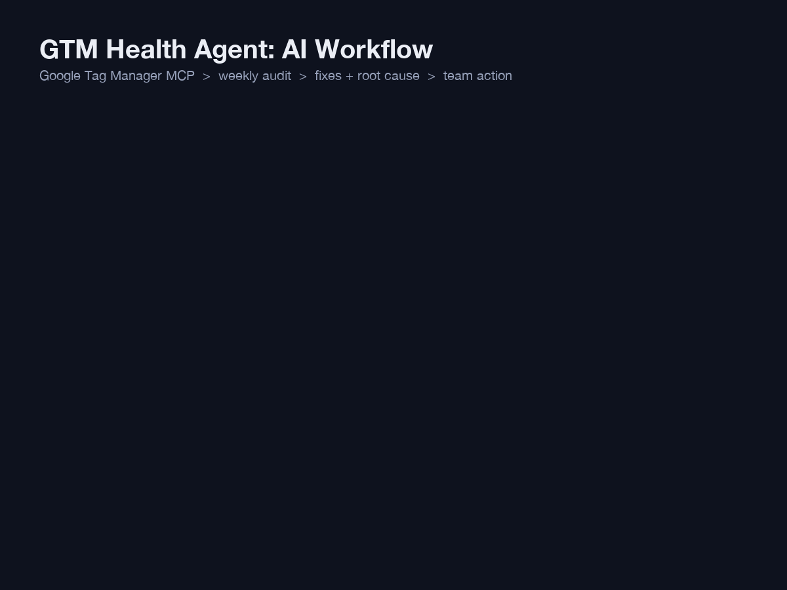

# GTM Health Agent: Weekly Tag Audit with AI

A Claude Code agent that audits **Google Tag Manager** every Monday. It flags tags, triggers, variables and containers that won't fire, explains the likely cause, and writes a fix list for the team.

> **Read-only.** The agent never creates, edits, pauses or publishes anything in GTM. It recommends; a human makes every change.

## How it works

| # | Step | What happens |
|---|---|---|
| 1 | Trigger | Runs every Monday at 8 AM as a scheduled task |
| 2 | Connect | Logs in through the GTM MCP connector and finds every account and container |
| 3 | Collect | Pulls the live version, workspaces, tags, triggers, variables and user permissions |
| 4 | Audit | 30+ checks: paused tags, deleted triggers, blocking triggers, broken `{{variables}}`, missing conversion IDs, duplicates |
| 5 | Score | Rates each issue P0 to P3 and gives each container a health score from 0 to 100 |
| 6 | Diagnose | Likely cause (recent publish, dataLayer change, expired schedule) and the exact fix in GTM |
| 7 | Compare | Marks each issue NEW, STILL OPEN or FIXED against last week |
| 8 | Report | Top 5 actions with owner and effort, full issue table, change log |

**Severity**
- 🔴 **P0**: revenue or conversion data lost now
- 🟠 **P1**: data wrong or at risk (duplicates, missing consent, personal data)
- 🟡 **P2**: will cause bugs
- ⚪ **P3**: housekeeping

Health score = 100 − (25×P0 + 10×P1 + 3×P2 + 1×P3)

**Extra checks:** Consent Mode v2 on Ads/Meta/Floodlight tags, personal data leaks, naming standard, publishes with no notes, who can publish, and changes left unpublished for more than 7 days.

> The GTM API shows how tags are set up, not whether they fired. Confirm P0 issues in GTM Preview mode or GA4 Realtime.

## Files

- [`agents/gtm-health-agent.md`](agents/gtm-health-agent.md): full spec with every check, severity rules and report format
- [`agents/weekly-task-prompt.md`](agents/weekly-task-prompt.md): the prompt the weekly scheduled task runs
- `gtm-agent-workflow.gif`: workflow infographic

## Requirements

- [Claude Code](https://claude.com/claude-code) (desktop app, for scheduled tasks)
- The **Google Tag Manager MCP connector**, signed in with a Google account that has access to your GTM accounts

## Set up

1. Open Claude Code and connect the GTM MCP connector.
2. Create a scheduled task that runs every Monday at 8 AM and paste in the prompt from `agents/weekly-task-prompt.md` (skip the top block between the `---` lines).
3. Click **Run now** once to approve the GTM tools, so later runs don't stop for permission.

Reports are saved to `~/gtm-health-reports/gtm-health-YYYY-MM-DD.md`.
